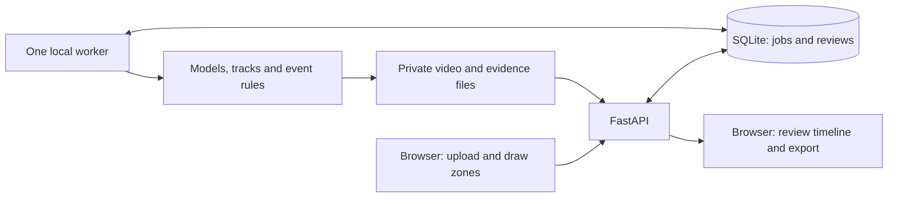

# Industrial Safety AI — upload and incident-review MVP

Status: proposed design for review; no frontend/backend implementation has started.

Visual direction selected by the user: **Evidence Focus, displayed option 2**. The user then requested meticulous Apple-inspired mockups of every screen before the build. The [refined screen set](/Users/tabbasi/Downloads/IndustrialAI/docs/design/2026-10-21-mvp-mockups/index.md), [design system](/Users/tabbasi/Downloads/IndustrialAI/docs/design/2026-10-21-mvp-mockups/design-system.md) and [interaction contracts](/Users/tabbasi/Downloads/IndustrialAI/docs/design/2026-10-21-mvp-mockups/interaction-spec.md) are the current visual handoff; the refined set is a review draft, not an implemented app.

## Agreed intent

The user selected **uploaded CCTV videos and incident review first**, and explicitly requested **all five capabilities: fire, smoke, smoking behavior, no helmet, and restricted-area intrusion**. Build a usable operator application around the current research project on this Mac. A reviewer must be able to inspect evidence, reject false alarms, record uncertainty and add missed incidents.

Assumptions for this proposal: one operator, one processing job at a time, local storage and Apple MPS, with CPU available only when explicitly selected. Browser access through an existing trusted remote connection or SSH tunnel is sufficient initially. Live streams, cloud deployment and notifications are later milestones. These assumptions can be changed without changing the agreed five-capability scope.

Success means the complete upload → configure → analyze → review → export workflow works for all five capabilities, including honest failure/visibility states. It does not mean that the current models have achieved production accuracy.

## Existing project and evidence

- `evaluate.py` runs three cached checkpoints, writes timestamped raw boxes/per-frame observations and records hashes. Its default 300-frame limit is an experiment limit, not full-video analysis.
- `temporal.confirm_timed` implements spatial voting with at least three hits spanning one second within a two-second window, IoU 0.1. Existing event utilities merge gaps of up to two seconds.
- Cached class maps were inspected: fire/smoke `{0: smoke, 1: fire}`, helmet `{0: Hardhat, 1: NO-Hardhat}`, cigarette `{0: cigarette}`. There is no person class in the helmet model.
- The latest comparison processed the same 33 clips/12,700 frames per checkpoint. Neither tested alternative clearly improves the current model. W04/W08 retain false smoke alerts; backlit plume misses remain. Tiny fine-tuning previously regressed.
- Smoking behavior, person association, zone entry and a web service are not implemented. A cigarette box alone cannot fill the smoking-behavior requirement.
- The Mac currently has Python 3.12, Ultralytics 8.4.183 and native `/usr/bin/avconvert`; FastAPI, its web runtime and tracking's `lap` dependency are not installed. Available disk space was approximately 12 GiB during planning.

## Architecture and alternatives

**Recommended: React/TypeScript/Vite + FastAPI + SQLite + one local worker.** Serve the built frontend from FastAPI so browser video, session cookies and API calls share one origin. The worker runs outside the API process and executes models sequentially on MPS. SQLite stores jobs and reviews; files store video and raw inference artifacts. Poll job status every two seconds; do not add WebSockets, Redis or Celery for this single-worker upload workflow.

Two alternatives were considered: a Python-only Streamlit dashboard is quicker for a disposable model demo but less suitable for the required video/zone/review interaction; a hosted frontend plus cloud GPU/backend adds deployment, recurring cost and footage transfers before they are needed. Neither is selected.

## Operator workflow and screens

1. **Video library:** upload, optional camera label, five capability toggles, file validation, queue/history and stage progress. Defaults select all five; selecting intrusion requires a zone before analysis can start.
2. **Video setup:** playable preview plus a thumbnail strip, polygon editor and explicit analysis settings. One upload can have several analysis jobs; each snapshots its settings and zones. Changing a zone creates a new analysis, not a rewrite of previous results.
3. **Review workspace:** video, synchronized overlays, capability-colored event timeline and incident list. Clicking an incident seeks to its evidence. Filters distinguish raw flags, temporal evidence and reviewer decisions. A reviewer can watch the whole clip and add a missed event with a start/end time.
4. **Incident history:** filter by capability, camera label, date and review decision; inspect evidence; export CSV/JSON and a selected incident evidence clip. Reviewer corrections remain an audit trail.

Use a restrained operator layout with one large video surface, compact controls, accessible text status labels and keyboard operation. Provide thumbnail/frame evidence alongside playback so a limited remote connection does not prevent basic review. Responsive behavior must preserve review actions at 390 px and the full workspace at 1440 px. No decorative analytics dashboard or fabricated statistics.

## Five-capability behavior

All thresholds below are explicit **provisional development rules**, recorded in each job. They are engineering starting points, not validated behavioral classifiers. Preserve all raw detections even when an event rule rejects them.

| Capability | MVP implementation | Required distinction |
|---|---|---|
| Fire | Current fire/smoke checkpoint, raw flags plus existing timed verification | Temporal evidence is not reviewer confirmation |
| Smoke | Same checkpoint and timed rule; retain short/weak flags for review | Steam, dust, bright backgrounds and haze can remain uncertain |
| No helmet | Current explicit `NO-Hardhat` detection associated with a tracked person's upper third | Missing a helmet box is not evidence of no helmet |
| Smoking behavior | Cigarette detector + same-person tracks + face/wrist evidence and hand-to-mouth motion | Cigarette-only and gesture-only observations remain raw evidence, not a smoking event |
| Restricted-area intrusion | Tracked person ground-contact estimate inside a user-drawn polygon, with dwell verification | A person first seen inside has unknown entry time; lost tracks do not prove exit |

### Shared person tracking

Add one official small pose checkpoint, proposed `yolo11n-pose.pt`, verified on MPS and pinned by artifact SHA before use. It supplies person boxes and nose/wrist keypoints. Use Ultralytics ByteTrack explicitly (`bytetrack.yaml`, `persist=True` for consecutive frames of this upload only); pin the tracking dependency and reset state between uploads. Do not depend on the library's changing default tracker. Track IDs are temporary IDs within one analysis, not identities across cameras.

With all five enabled, analyze original frames in four sequential passes: pose/tracking, fire/smoke, helmet and cigarette. Skip passes not needed by the selected capabilities. Join evidence by source frame index/timestamp. This bounds GPU memory and reuses pose results for both behavior and intrusion. Do not claim real-time throughput; measure processing time on this Mac. Merge person-specific events only within the same job, kind, track and zone; never merge two people's overlapping events together.

### PPE and smoking rules

- Match a head/cigarette observation to a single eligible person. If two people are similarly plausible, retain an unassigned raw flag and mark association uncertain.
- No-helmet event: explicit no-helmet box associated with the same track on at least three observations spanning one second within two seconds. A head box smaller than 12 px in either dimension is too small for the default assessment; retain its raw flag.
- Smoking assessment requires person height at least 80 px and nose/relevant wrist confidence at least 0.5. A wrist is near the face when its distance to the nose is at most 0.15 times person height; it is away at 0.25 or more. Values between these thresholds retain the previous gesture state to reduce jitter.
- A cigarette center must be inside the person's box and within 0.20 person heights of the nose or relevant wrist. Require at least three such observations spanning one second within a two-second window, plus an observed away → near → away gesture cycle on that track within eight seconds. Emit a **suspected smoking** review candidate when the cycle completes; attach the supporting interval. A cigarette box or hand gesture alone never emits a smoking event.
- Missing pose points, very small people, ambiguous associations or a track gap over one second reset the gesture evidence and mark the affected assessment interval uncertain. These rules will miss some genuine smoking and can still confuse eating/phone use if cigarette detections are wrong. Positive and difficult-negative footage is a release validation requirement.

### Zone rules

Zones use normalized source-image coordinates `[0,1]`, three to 32 distinct vertices, nonzero area, no self-intersections. The editor must convert letterboxed display coordinates correctly. Each zone has a name and immutable job copy.

Use the bottom-center of the person box as an estimated ground-contact point. Boundary points count as inside. Require three inside observations spanning one second, with no observation gap over one second, before emitting an incident. Outside observations spanning two seconds end it. A clipped person box or ambiguous/lost track cannot establish a reliable entry/exit; retain uncertainty. An initial-inside incident is labeled `presence; entry time unknown`; an observed outside-to-inside transition is `entry observed`. IDs are scoped by job, track and zone.

## Processing, media and persistence contracts

- Initial upload limits: **250 MiB, five minutes, maximum 1920×1080, maximum nominal 60 FPS**. Accept MP4/MOV/AVI/MKV only if the actual decoder and timestamp preflight pass. Display limits before upload. Send a raw `application/octet-stream` file body to `POST /api/uploads`, with a sanitized display filename in `X-Upload-Name`; stream/count chunks directly before any multipart parsing or full-file buffering. Reject unsupported files with an actionable reason.
- Run lightweight format/metadata checks at admission; queue full decode/preview preparation as a `prepare_upload` job and return 202 with `upload_id` and `preparation_job_id`. Full preflight also enforces actual timestamp duration/count limits, catching misleading container metadata. A later validation failure is an explicit failed preparation job with an error code; it cannot be retroactively returned as an HTTP upload rejection. Analysis requires a ready preview.
- Do not call inference in the HTTP request. Persist a job, return 202, then let one worker claim it transactionally. Keep the API responsive during GPU work.
- Job kinds: `prepare_upload`, `analyze`, `export`, on the same queue. States: `queued`, `running`, `completed`, `partial`, `failed`, `cancelled`, `interrupted`. A requested capability failure makes an analysis partial, not successful across all five. Preserve successful outputs and show exactly which capability failed. Processing completion and visual assessability are separate fields.
- Cancel between frames and while polling media-conversion subprocesses. Hold a single worker lock; on worker restart, mark orphaned running work interrupted and require an explicit retry, creating a new job. Pending jobs remain queued. Do not duplicate incidents on retry.
- Report named stages and processed/expected frames, not an invented ETA. Process the full admitted file; never silently stop after the runner's default 300 frames.
- Persist original bytes/hash, model/checkpoint hashes and names, profile/zone snapshots, original source times, per-frame success, raw detections, track/pose evidence, event rules, incidents and append-only reviewer decisions. Raw model class strings remain intact with a versioned canonical map.
- SQLite tables: `uploads`, `jobs`, `incidents`, `reviews`, `artifacts`; structured job configuration/capability summaries are JSON fields. Use foreign keys, WAL and a busy timeout. Use stdlib `sqlite3`, not an ORM/migration service for schema v1.
- Store runtime files under ignored `var/mvp/`, separate from `benchmark/`, `data/labeled/` and historical reports. Never auto-add uploaded footage or reviewer edits to training data.
- At admission and during processing enforce **4 GiB MVP storage quota and 3 GiB minimum free disk**. Count temporary files. Clean partial uploads/conversions on failure. No background deletion of user evidence; provide explicit deletion after any running job has been cancelled. Keep deletion retryable if filesystem cleanup fails.

### Browser playback and timestamps

Generate an H.264 MP4 preview using existing OpenCV plus native `avconvert`; preserve the original upload for inference. Use a frame-preserving constant-rate intermediate and store an explicit original-frame/source-time ↔ preview-time map. Verify preview frame count and decoded timing after conversion. If conversion duplicates/drops frames unexpectedly, fail the preview stage rather than assume correct alignment. Original audio is not carried into analysis previews.

Use this map for incident seeking, overlays, zone editing and evidence clipping. Exports identify original source times; do not substitute re-encoded playback times. Serve private media through authenticated ID-based endpoints supporting HTTP byte-range requests so the browser can seek. Source paths are never accepted from the client. Evidence clips include two seconds of context on either side when available and declare their source interval/mapping.

### Review states and unknowns

Machine fields (`kind`, raw/temporal evidence, confidence, track, source interval) remain separate from reviewer decisions: `unreviewed`, `confirmed`, `false_alarm`, `uncertain`. Append corrections with time and note; do not overwrite the original prediction. Manually added missed incidents have `origin=manual` and explicit source intervals, and are created atomically with an initial human `confirmed` or `uncertain` review chosen in the dialog. Notes allow 1,000 characters; do not copy illustrative counters from raster mockups. Mutating job creation, review, manual-incident and export requests carry a client request UUID with a unique database constraint, so a retried request returns its earlier result. Reviews additionally carry an expected version; stale edits return 409.

Display **No candidates detected** only after an analyzed interval with successful inference. Never display **safe/compliant** from absent detections. Report processing coverage separately from whether a person/head/gesture could be assessed. Disabled capabilities, decoder gaps, missing model files, obscured people and failed inference must stay distinguishable. A zero-incident failed job is not a negative result.

## API outline

- `POST /api/session`, `DELETE /api/session`, `GET /api/health`, `GET /api/capabilities`.
- `POST /api/uploads`, `GET /api/uploads`, `GET /api/uploads/{id}`, `DELETE /api/uploads/{id}`.
- `POST /api/uploads/{id}/jobs` with capability list, device and zones; `GET /api/jobs/{id}`, `POST /api/jobs/{id}/cancel`.
- `GET /api/jobs/{id}/incidents`, `POST /api/jobs/{id}/incidents` for a missed event, `POST /api/incidents/{id}/reviews` for an append-only review.
- `GET /api/jobs/{id}/observations?start=...&end=...` for bounded overlay/track pages; no full-video JSON payload in one response.
- `GET /api/artifacts/{id}` for preview, thumbnail, evidence and downloads; `POST /api/jobs/{id}/exports` to queue CSV/JSON or a selected evidence clip in the same worker.

Return 413 for an upload byte-limit violation, 422 for synchronous invalid metadata/configuration/zones, 409 for incompatible state, and 507 for insufficient storage. Asynchronous full-decode failures are reported in the preparation job's status/error. Export generation is cancellable worker work, not a long blocking API request. API schemas generate frontend types; do not maintain two inconsistent contracts manually.

## Remote access and basic access control

One operator login with a locally configured hashed password and signed HttpOnly SameSite session cookie. Enforce session checks on uploads, originals, previews, thumbnails, overlays and exports. Use CSRF protection on state changes and same-origin requests; rate-limit login attempts. Bind to loopback by default. Use an existing VPN or SSH port forwarding for remote browser access; do not open a public port or create a tunnel/service account as part of this implementation. HTTPS is required before non-loopback network exposure; secure-cookie settings follow the selected transport.

Do not accept arbitrary filesystem paths, remote URLs or checkpoint uploads through the API. Model registry entries are server-controlled and SHA-pinned. Commercial distribution will require checking upstream licenses; this plan does not change the existing local research-use posture.

## Build sequence and acceptance

1. Working authenticated upload → queued local job → playable result → saved review, initially using fire/smoke.
2. Shared person/pose tracking, no-helmet association and polygon intrusion, with clear uncertain cases.
3. Smoking behavior evidence fusion, with raw-cigarette-only cases kept distinct.
4. Complete five-capability workspace, history, missed-event entry, exports, storage/recovery controls and remote-browser verification.

The first slice is an implementation milestone, not a reduction of the final five-capability MVP.

Engineering acceptance: all five workflow paths exercised; original timeline alignment checked; API responsive during processing; progress/cancel/restart correct; private media inaccessible anonymously; review state persists after restart; exports reproduce evidence/decisions; existing CLI tests still pass. Browser checks cover Chrome/Safari playback, range seeking, keyboard use and narrow screens. Model evaluation is a separate gate: show known false alarms/misses honestly, and report smoking/intrusion accuracy as unvalidated until adequate real positive and difficult-negative clips exist. Synthetic fixtures test rules but cannot establish detector accuracy.

## Explicitly later

RTSP/live camera ingestion, multi-camera scheduling, cloud GPUs, multi-organization permissions, external notifications, mobile apps, automatic retraining, certified safety claims and enterprise analytics. Add these after the upload/review product demonstrates value and performance is measured.

## Technical references checked during planning

- [React's client-side app/Vite guidance](https://react.dev/learn/build-a-react-app-from-scratch).
- [FastAPI uploads](https://fastapi.tiangolo.com/tutorial/request-files/) and [heavy-background-work caveat](https://fastapi.tiangolo.com/tutorial/background-tasks/): keep inference outside request handling.
- [Starlette FileResponse](https://starlette.dev/responses/): byte-range support for seekable media.
- [Ultralytics tracking](https://docs.ultralytics.com/modes/track/) and [YOLO11 pose variants](https://docs.ultralytics.com/models/yolo11/): reuse the installed runtime, select ByteTrack explicitly, verify and pin a pose artifact before implementation.
