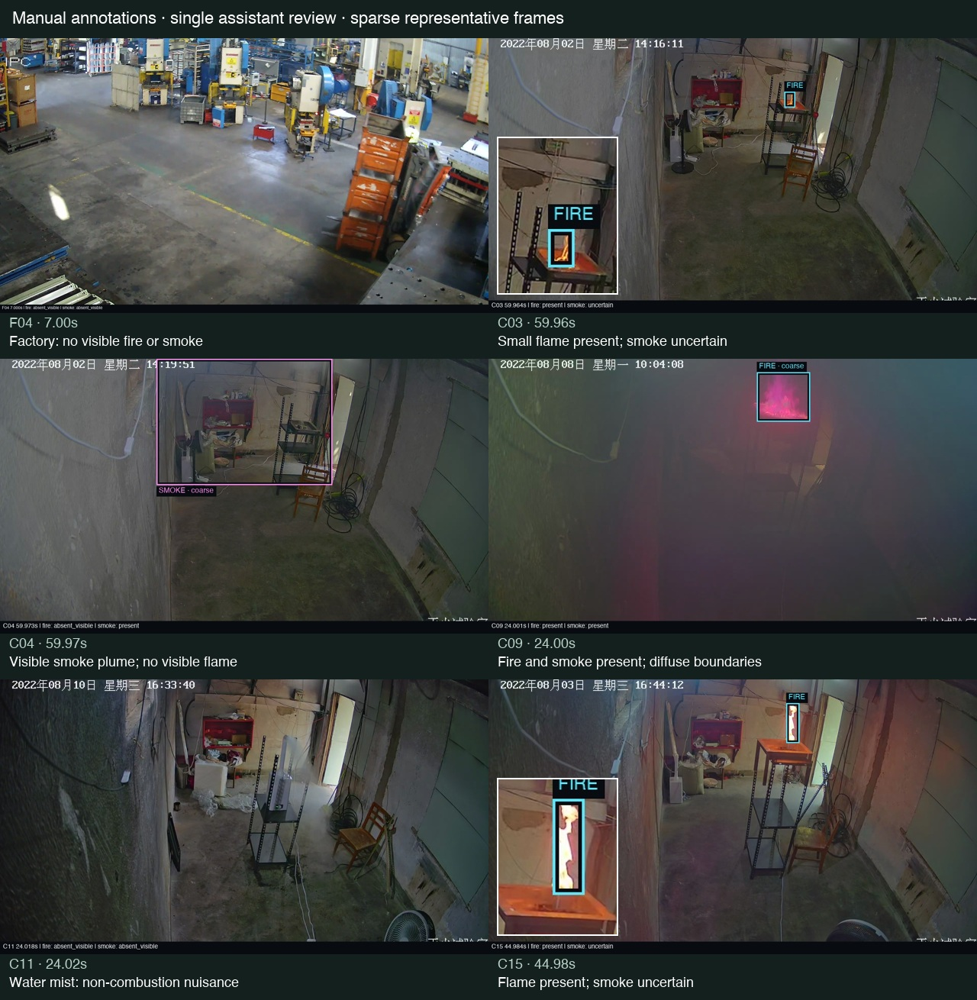

# Fire and smoke annotations — 22 October 2026

Annotated all **23 acquired short clips (13.6 minutes)** for visible fire and combustion smoke. The batch contains **69 selected frames**, **18 flame boxes** and **4 coarse smoke boxes**. Eight factory clips and four laboratory clips are negative for visible fire/combustion smoke, including a documented water-mist nuisance and its following blank control.

These are **single-assistant visual annotations**, authorized by the user, not human-confirmed or independently reviewed ground truth. They are saved separately from application reviews. No model training, threshold change, application update or dataset admission was performed.



## Labels and timing

Times below are **seconds relative to the short clip**, not the original long recording. “Whole clip” covers its actual decoded duration. Positive events continuing at the end are right-censored: the end of the excerpt does not establish extinction or smoke clearance. Fire in C03 and C07 is already visible at frame zero; the earlier acquisition descriptions did not establish ignition times.

| Clip | Duration | Fire | Combustion smoke | Observation |
| --- | ---: | --- | --- | --- |
| F01 | 16.976 | Absent visible | Absent visible | Machinery, moving workers, floor reflections |
| F02 | 20.766 | Absent visible | Absent visible | Machinery and worker movement |
| F03 | 11.031 | Absent visible | Absent visible | Machine operator, bright floor |
| F04 | 13.000 | Absent visible | Absent visible | Moving orange forklift, reflective floor |
| F05 | 15.636 | Absent visible | Absent visible | Machinery, seated and walking workers |
| F06 | 15.008 | Absent visible | Absent visible | Machinery, bright workwear and floor |
| F07 | 6.005 | Absent visible | Absent visible | Workers walking past machinery |
| F08 | 12.124 | Absent visible | Absent visible | Reflective floor; forklift enters near end |
| C01 | 30.000 | Absent visible | Absent visible | Clear room, bright doorway |
| C02 | 30.000 | Absent visible | Absent visible | People moving chairs and equipment |
| C03 | 60.000 | Present, whole clip | Uncertain, whole clip | Small flames already burning; smoke not reliably resolved |
| C04 | 60.000 | Absent visible | Present, whole clip | Rising pale plume and spreading upper-room haze |
| C05 | 45.026 | Uncertain | Present, whole clip | Dense room haze; obscured bright doorway |
| C06 | 45.005 | Uncertain | Present, whole clip | Dense haze; warm doorway patch unresolved |
| C07 | 60.000 | Present, whole clip | Uncertain, whole clip | Tiny flame already present on board; grows |
| C08 | 45.000 | Present, whole clip | Uncertain 0–30.030; present 30.030–45.000 | Growing flame and increasingly clear gray veiling |
| C09 | 45.034 | Present, whole clip | Present, whole clip | Pink/exposure-shifted flickering flame through thick smoke |
| C10 | 45.032 | Uncertain | Present, whole clip | Persistent room-wide haze; flame contour unresolved |
| C11 | 45.011 | Absent visible | Absent visible | Documented water mist, **not combustion smoke** |
| C12 | 45.016 | Absent visible | Absent visible | Clear post-mist blank-control interval |
| C13 | 45.011 | Uncertain | Present, whole clip | Residual haze; bright doorway and occlusion |
| C14 | 60.000 | Present, whole clip | Uncertain, whole clip | Tall yellow flame; faint smoke/heat appearance unresolved |
| C15 | 45.024 | Present, whole clip | Uncertain, whole clip | Saturated white/yellow flame; possible faint smoke unresolved |

C08's 30.030-second boundary means **first confidently positive sampled visibility**, not the physical start of smoke. Earlier frames are excluded, not counted as clean negatives. The retained timestamp precision identifies the actual sampled video frame; it does not imply millisecond annotation accuracy. The current excerpts do not provide a measured physical ignition onset for latency evaluation.

## What the files contain

- [manifest.jsonl](manifest.jsonl): 23 clips, source SHA-256 hashes, local paths, permission/provenance and conservative source groups; compatible with the existing benchmark validator.
- [annotations/](annotations/): one JSON per clip, with reviewed/excluded class intervals, events, nuisance tags, selected frame timestamps and indices, image hashes, original-pixel `bbox_xyxy` coordinates and notes. For example, [C04](annotations/C04.json) contains plume boxes; [C11](annotations/C11.json) records water-mist provenance.
- [review-ledger.json](review-ledger.json): readable clip-level decisions and uncertainty notes.
- [review-evidence.json](review-evidence.json): all **492 inspected chronological sample references**, their exact frame times/indices and hashes, plus local contact-sheet paths and hashes. Full-resolution samples remain under `data/cctv-annotations-2026-10-22/`.
- [Box check 1](box-check-1.jpg), [box check 2](box-check-2.jpg): all box-bearing selected frames, with flame detail crops. Cyan marks flame; pink marks coarse smoke. Boxes exclude the orange pan, red workwear, wall glow and doorway light. Very small flames may occupy only a few pixels.
- [Evidence 1](evidence-1.jpg), [2](evidence-2.jpg), [3](evidence-3.jpg), [4](evidence-4.jpg): all 69 selected frames, including clear negatives and partial/uncertain frames.
- [verify.py](verify.py), [verification.json](verification.json): runnable integrity, coverage, class-completeness and source-frame alignment checks and their result.

Review used unannotated chronological samples every **1 second for factory clips** and **2 seconds for laboratory clips**, plus the final decoded frame of each clip. Native-pixel crops were inspected for small flames, plume boundaries and C08's smoke-confidence boundary. No model detections, confidence thresholds, automatic box propagation or interpolated labels were used. This is sampled temporal review and **sparse frame annotation**, not exhaustive annotation of every video frame or all 350.7 minutes of parent recordings. Brief events between samples can be missed.

### Uncertainty and training handling

There are **39 class-complete reviewed frames**: 36 clear negative frames and three C04 smoke frames with coarse plume boxes. The other **30 frames** are marked `review_status: ambiguous` because one class is uncertain or visible room haze cannot be completely localized. A reliable flame box in a partial frame does not make the missing smoke box a negative. Three C09 flame envelopes and C08's last-frame smoke envelope additionally carry ambiguous object-boundary status. In total, 18 object boxes are single-reviewer accepted and four are boundary drafts.

Smoke in C05, C06, C09, C10 and C13 is visibly present, but its diffuse room-wide extent is not forced into a guessed tight box. Their selected frames remain excluded from box scoring. Event-level labels remain available. A frame-level empty object list in an ambiguous frame **must not** be exported as a clean negative.

Uncertain class intervals are explicitly excluded from temporal scoring. There are six clips with reviewed fire presence, seven with reviewed smoke presence, four with uncertain fire visibility and four with wholly uncertain smoke visibility; C08 additionally has an uncertain early smoke interval. Counts overlap because a clip can contain both fire and smoke.

All 23 clips remain **development-only and not admitted for training**. A flat YOLO export was intentionally not created: it would discard class-specific uncertainty and turn incompletely localized haze into false negatives. These annotations can support the next review/evaluation step; they do not establish that retraining improves the system. Only fire and combustion smoke were annotated, not smoking behavior, helmet use or restricted-area intrusion.

## Source grouping and attribution

Factory F01–F08 come from [Önal and Dandıl, Video Dataset for Safe and Unsafe Behaviours](https://data.mendeley.com/datasets/xjmtb22pff/1), DOI `10.17632/xjmtb22pff.1`, CC BY 4.0. They share the existing factory development facility/camera families, so the conservative group remains `workplace-all`. These additional files are not independent unseen-factory validation.

Laboratory C01–C15 derive from [Jia et al., MmodalFire v1](https://doi.org/10.6084/m9.figshare.28804448.v1), CC BY 4.0. All share the conservative `mmodalfire-xian-ch01` site/camera family and stay in one dataset role. Parent IDs, source hashes, trim offsets and nominal parent-time mappings are retained in each laboratory annotation. The camera clock and variable/native trim timing do not establish frame-exact cross-recording alignment.

C11's water-mist identity uses the source worksheet's Mist4 window (10 August, approximately 16:31–16:37) and retained camera clock, not appearance alone. C12 lies in the following blank-control window. No selected clip is labeled as verified dry ice. Source download verification details, including the **unverified whole-archive MD5**, remain in the [acquisition report](../cctv-acquisition-2026-10-22/report.md). Changes to the source material here are native short excerpts, sparse manual labels and derived visual evidence; source videos remain local.

## Verification

From the repository root:

```sh
.venv/bin/python scripts/benchmark_data.py reports/cctv-annotations-2026-10-22/manifest.jsonl
.venv/bin/python reports/cctv-annotations-2026-10-22/verify.py
```

Checks cover clip hashes, permitted schema, in-bounds boxes, complete reviewed/excluded time partitions, single dataset role per source group, all 492 cached sample hashes, and fresh source decoding to match all 69 selected frame images and presentation timestamps. These checks verify integrity and consistency, not independent annotation correctness. Visual review of both box-check sheets and the representative preview was completed.
