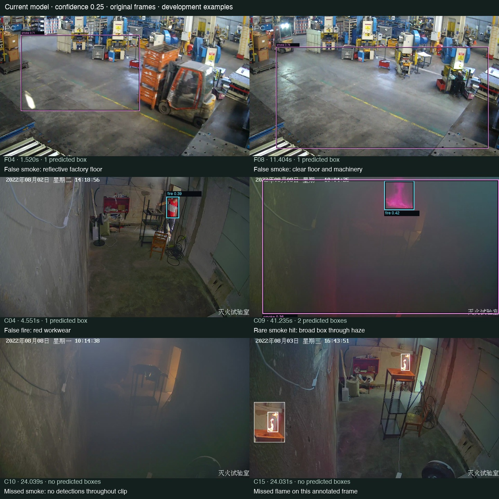

# Current-model baseline — 22 October 2026

**The smoke detector needs substantial improvement.** On these development excerpts, the current app produces a smoke candidate in **3 of 7 smoke-positive clips** and misses four. Stricter elapsed-time confirmation retains **1 of 7**, while preserving both persistent factory-floor false alarms. Fire candidates occur in all six fire-positive clips, but small-flame detections are sparse and several confirmations arrive tens of seconds into an already-burning excerpt.

Completed fresh inference on **all 23 clips, all 20,400 frames**, using the application's pinned original checkpoint at confidence **0.25**, image size **640**, stride **1**, Apple **MPS**, and container presentation timestamps. No threshold, model, application code, annotation or saved review was changed. No training was performed.



## Primary results

“App candidates” reproduces `backend.pipeline.fire_incidents`: every merged raw fire/smoke candidate is retained as an incident; temporal confirmation adds an evidence badge. “Timed only” scores only causally confirmed observations: at least three overlapping same-class observations in two seconds, spanning at least one second. Both policies merge candidate intervals separated by at most two seconds. The stricter rule was evaluated offline, not deployed.

| Policy | Capability | Positive clips with a matching event | Missed positive clips | False events in negative scenes | Negative-scene false events/min | Extra repeat events during positives |
| --- | --- | ---: | ---: | ---: | ---: | ---: |
| App candidates | Fire | 6/6 | 0 | 2 | 0.37 | 13 |
| Timed only | Fire | 5/6 | 1 | 1 | 0.19 | 1 |
| App candidates | Smoke | 3/7 | 4 | 3 | 0.69 | 2 |
| Timed only | Smoke | 1/7 | 6 | 2 | 0.46 | 0 |

A “matching event” means at least one **class/time overlap** with a reviewed positive interval; it does not establish sustained detection or spatial correctness. Events in different excerpts of the same burn are counted separately here, not treated as independent incidents. Review labels are from a single assistant. The smoke-positive and fire-positive clip counts overlap.

The negative denominators are only **4.34 minutes for smoke** and **5.34 minutes for fire**, after class-specific uncertainty/coverage exclusions. These short development rates should not be extrapolated to operating days. “Negative-scene false events” counts candidate events overlapping reviewed negative time. The existing benchmark's all-unmatched count also includes repeat alerts during a positive incident: app fire has **15 unmatched** events (2 negative-scene + 13 repeats); app smoke has **5** (3 negative-scene + 2 repeats). Its all-unmatched rates are 2.81/min for fire and 1.15/min for smoke. Both definitions are saved in [metrics.json](metrics.json).

## Why event hits overstate reliability

- **Smoke:** only **26 of 7,509 analyzed frames in reviewed smoke-positive time** contain any smoke box: **0.35%**. Current app merged alert spans overlap about **2.28 seconds of 300.08 smoke-positive seconds**, approximately 0.76%; merging can bridge gaps up to two seconds, so this is not continuous detection. C04, C05, C10 and C13 receive no smoke detections at all. C06 receives ten smoke-hit frames, C08 one, and C09 fifteen. The timed rule retains only one approximately **40-millisecond observation** in C09.
- **Fire:** **2,137 of 7,882 fire-positive frames** have a fire box: **27.1%**. The larger fire clips C08/C09 dominate those hits. C07 has 22 fire boxes in 1,501 frames, C14 has 21 in 1,501, and C15 has six in 1,126. Timed fire confirmation first appears at approximately **43.65 s in C03**, **51.53 s in C07**, and **53.44 s in C14**; C15 never confirms. These times start at the excerpt/first visible evidence, **not physical ignition**, which predates the clip.
- **Persistent false smoke:** F04's merged app smoke span covers about 12.08 of 13 seconds; timed-only spans still cover 8.20 seconds. F08's app span covers essentially its entire 12.12 seconds and timed-only still covers 11.12 seconds. Visual inspection places these boxes over clear reflective factory floor/background, not visible smoke. Temporal persistence alone does not remove them.
- **False fire on workwear:** C04's strongest fire box (0.393 at 4.551 s) lies on the person's red shirt. The smoke plume in this clip is missed. Fire predictions in the more obscured C05/C06/C10/C13 clips remain excluded where fire visibility was labeled uncertain; they are not silently counted as correct or false.
- **Confidence overlap:** the largest smoke confidence during reviewed positive smoke time is **0.417**, while the negative factory-floor example reaches **0.758**. Post-filtering this run at 0.50 would remove every smoke candidate in reviewed positive time while leaving some factory false positives. Raising the global threshold does not separate these observed examples.

These observations support improving detection/labels and validating replacements. They do not support making confirmation stricter or raising confidence as the sole fix.

## Clip-by-clip results

“Clear” means no candidate event in reviewed negative time. “Hit” means at least one class/time overlap; “Miss” means no overlap despite monitored positive time. Repeats are extra unmatched events during a labeled incident. “Excluded” means the class is uncertain, not a successful negative. C08 smoke scoring excludes the first 30.030 seconds.

| Clip | App fire | Timed fire | App smoke | Timed smoke | Finding |
| --- | --- | --- | --- | --- | --- |
| F01 | Clear | Clear | Clear | Clear | No fire/smoke candidates |
| F02 | Clear | Clear | Clear | Clear | No fire/smoke candidates |
| F03 | Clear | Clear | Clear | Clear | No fire/smoke candidates |
| F04 | Clear | Clear | 1 false | 1 false | Persistent floor false smoke, peak 0.709 |
| F05 | Clear | Clear | Clear | Clear | No fire/smoke candidates |
| F06 | Clear | Clear | Clear | Clear | No fire/smoke candidates |
| F07 | Clear | Clear | 1 false | Clear | Brief smoke false alarm removed by timed rule |
| F08 | Clear | Clear | 1 false | 1 false | Persistent floor false smoke, peak 0.758 |
| C01 | Clear | Clear | Clear | Clear | No fire/smoke candidates |
| C02 | Clear | Clear | Clear | Clear | No fire/smoke candidates |
| C03 | Hit + 2 repeats | Hit | Excluded | Excluded | First timed fire at 43.65 s |
| C04 | 2 false | 1 false | Miss | Miss | Red workwear produces fire false alarms; smoke missed |
| C05 | Excluded | Excluded | Miss | Miss | Smoke missed; fire visibility excluded |
| C06 | Excluded | Excluded | Hit | Miss | Only ten smoke-hit frames; timed smoke misses |
| C07 | Hit + 2 repeats | Hit + 1 repeat | Excluded | Excluded | First timed fire at 51.53 s |
| C08 | Hit | Hit | Hit | Miss | One smoke-hit frame, at 38.188 s; first 30.030 s excluded |
| C09 | Hit | Hit | Hit + 2 repeats | Hit | Only 15 smoke-hit frames; one timed hit lasting ~0.04 s |
| C10 | Excluded | Excluded | Miss | Miss | Residual haze entirely missed |
| C11 | Clear | Clear | Clear | Clear | Documented water mist correctly yields no detections |
| C12 | Clear | Clear | Clear | Clear | Blank control correctly yields no detections |
| C13 | Excluded | Excluded | Miss | Miss | Residual haze entirely missed |
| C14 | Hit + 6 repeats | Hit | Excluded | Excluded | First timed fire at 53.44 s |
| C15 | Hit + 3 repeats | Miss | Excluded | Excluded | Six raw fire-hit frames; no timed confirmation |

## Sparse localization spot check

The interval benchmark does not verify every predicted box. A separate descriptive spot check uses the saved original-pixel manual boxes and exact matching source frame indices. Each class is admitted separately: a reviewed flame box can be checked even when the same frame's smoke class is uncertain. Uncertain classes, incomplete/diffuse smoke localization and ambiguous object boundaries are excluded; they never become empty negative labels.

| Class | Scorable selected frames | Positive boxes | Matched at IoU ≥0.50 | Missed boxes | Unmatched predicted boxes |
| --- | ---: | ---: | ---: | ---: | ---: |
| Fire | 54 | 15 | 4 | 11 | 1 |
| Smoke | 39 | 3 | 0 | 3 | 4 |

At IoU ≥0.30, fire matches 5/15 and smoke remains 0/3. These tiny, deliberately selected samples are **not mAP estimates** or an independent localization benchmark. They further show why a clip-level fire hit does not imply reliable detection throughout the clip.

## Recommended next development work

1. Expand reliable smoke-positive box labels across plume density, distance, lighting and motion; collect more visible small-flame examples and preserve ambiguous boundaries. Keep room-wide unlocalizable haze as temporal labels rather than guessing tight boxes.
2. Collect confusing negatives from additional factory cameras: reflective floors, backlighting, moving equipment and red/orange workwear. This batch's factory footage shares the existing development facility, so keep it in development rather than training against the same evaluation scene.
3. Obtain separate camera/site groups and label review for validation. All laboratory excerpts here share one conservative camera family; repeated excerpts from the same experiment cannot establish generalization.
4. Compare a smoke-focused trained candidate or alternative detector against this unchanged baseline. Require better smoke coverage, fewer negative-scene alarms, preserved small-flame sensitivity and stable event timing before any model/profile change. No operating target or promotion decision has been accepted from this small batch.

The existing three class-complete smoke-positive boxed frames are insufficient for useful fine-tuning. This run establishes concrete failure cases and a reproducible comparison baseline; it does not establish training improvement.

## Artifacts and reproducibility

- [metrics.json](metrics.json): exact application and four existing benchmark policies, per-clip event metrics, raw frame hit counts, class-specific sparse localization checks and application event records.
- [per-clip.csv](per-clip.csv): compact event results for every clip/class/policy.
- [benchmark.json](benchmark.json): existing benchmark output with coverage/exclusions, raw/legacy/fixed-2Hz/timed policies, latency and pinned source/model/code provenance.
- [inference-spec.json](inference-spec.json), [runs.json](runs.json), [embedded-classes.json](embedded-classes.json): model/config/code identity and local inference run location. The checkpoint embeds `0: smoke`, `1: fire`; class names were checked against the app registry.
- [confidence-observations.json](confidence-observations.json): confidence maxima and box counts in reviewed positive/negative time.
- [evidence-index.json](evidence-index.json): six exact source frames, timestamps, boxes and example-selection basis. The figure shows peak-confidence false positives/one positive smoke example and middle annotated frames for two misses; it is illustrative, not a random sample.
- [verification.json](verification.json): final integrity and reconciliation checks.

The checkpoint SHA-256 is `b91633799ceb052c814b4f8b77a37efc9a40f002d528df97d74463585fa4f28f`, repository `rabahdev/fire-smoke-yolov8n`, pinned revision `13017fe8af477c25f5298d168e2dfede4b000753`. Inference took approximately **225.8 seconds** including decoding, plotting and local annotated-video encoding. Measured model prediction/box-transfer latency was approximately **7.63 ms median / 12.86 ms p95**; this is an offline single-model run, not live application capture-to-alert latency.

Raw detections, every analyzed-frame timestamp, run metadata and annotated videos remain at `/Users/tabbasi/Downloads/IndustrialAI/outputs/cctv-baseline-2026-10-22/run-xzlp2ba9` (about 334 MB, ignored by Git). The report and source references are retained in the repository. Dataset sources, permissions, conservative groups and annotation limitations are in the [annotation report](../cctv-annotations-2026-10-22/report.md) and [acquisition report](../cctv-acquisition-2026-10-22/report.md). The original 23 clips are unchanged.

Recompute the metrics from the saved complete run:

```sh
.venv/bin/python reports/cctv-baseline-2026-10-22/analyze.py --self-check
.venv/bin/python reports/cctv-baseline-2026-10-22/analyze.py
```

The analysis reuses the existing inference reader, benchmark scorer, temporal functions, application incident function and box matcher. It verifies hashes, complete per-source frame counts, unchanged inference/application code, class-specific exclusions and agreement of per-clip totals with the existing benchmark. The existing benchmark/data/evaluation tests also passed: **14 tests**. There was no application restart or modification to model, thresholds, annotations, database or saved reviews.
