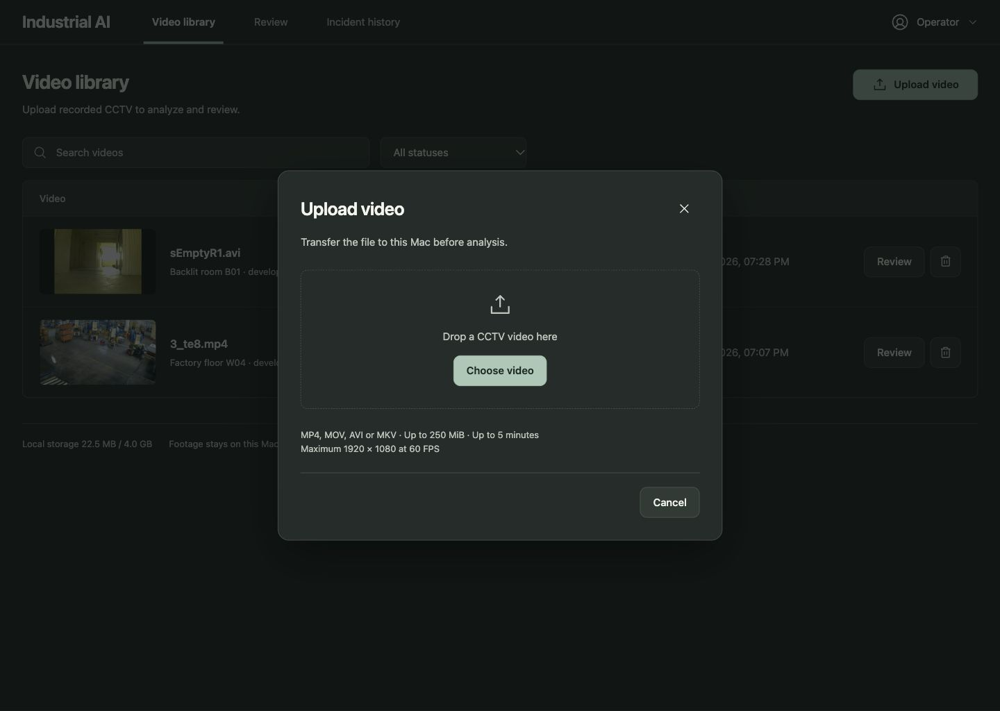
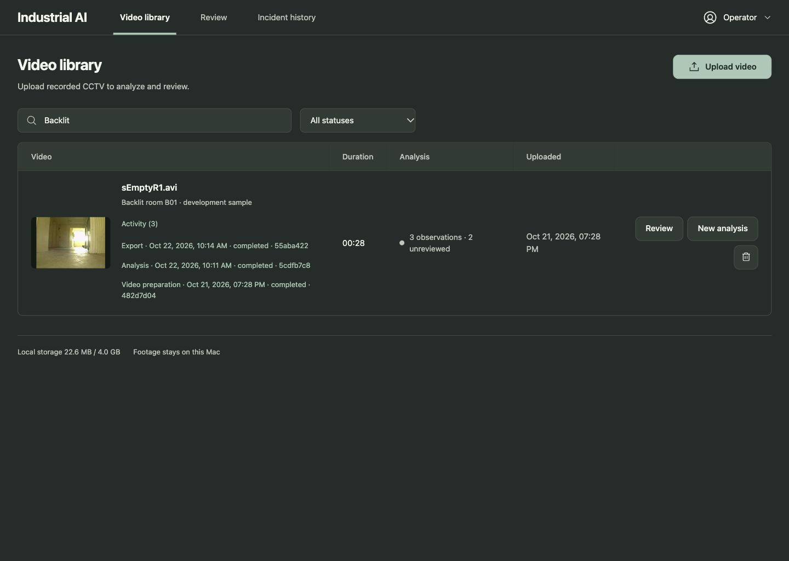
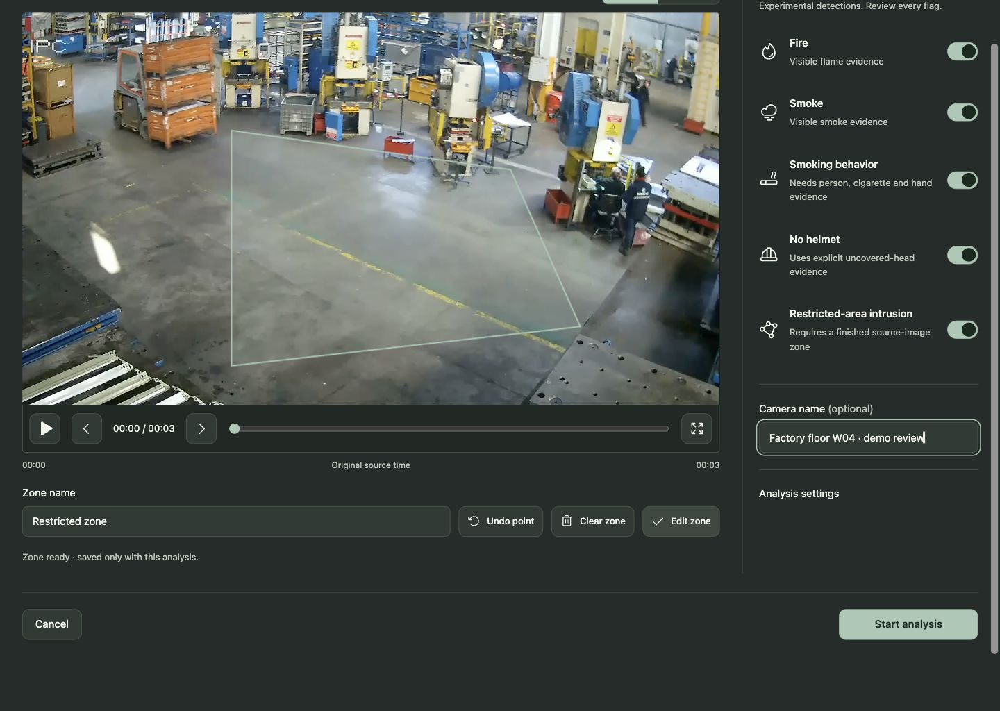
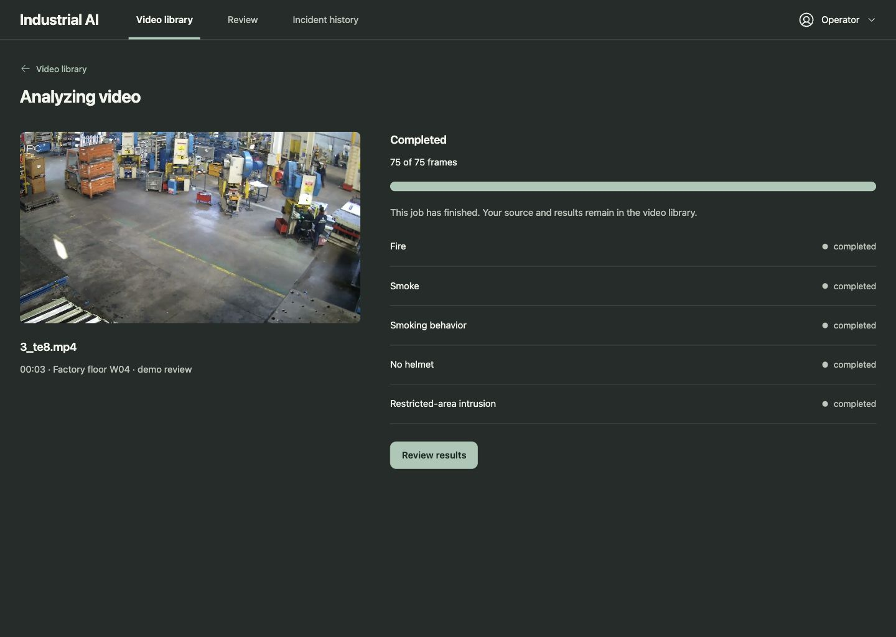
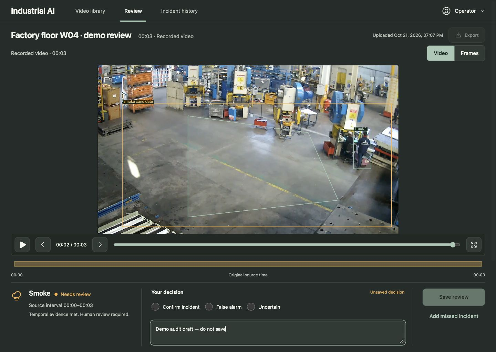
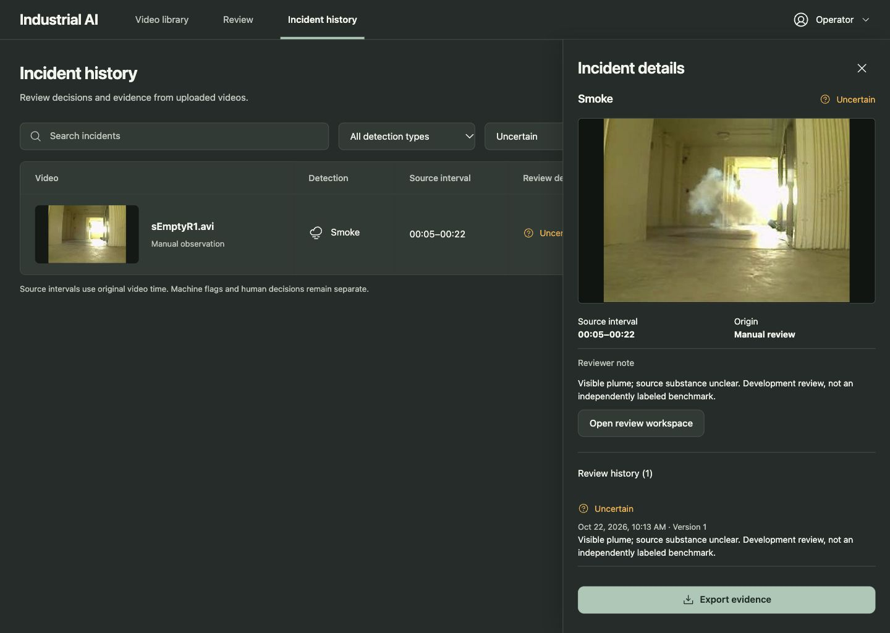

# Demo readiness audit — 22 October 2026

The local upload-to-review workflow runs with all five integrated pipelines. The audit found and fixed functional defects affecting repeat demonstrations and review reliability. This is a supervised development demo, not a production safety-system validation.

The browser acceptance pass remains incomplete: a native confirmation over the old manual-observation dialog stalled the in-app browser's automation. The tool could neither dismiss the prompt nor close the affected tab. The user has been asked to dismiss it. Its replacement uses explicit in-form Keep editing / Discard observation controls and passes a regression test, but the final browser check is pending.

## Scope and evidence

Reviewed the existing Graphite/Sage React frontend and FastAPI/SQLite backend on this Mac at port 8008. Used Product Design audit, systematic debugging, regression-first checks and verification-before-completion. No new dependency, training run, cloud service or public deployment was added.

Only screenshots captured in this audit support the visual findings below. For tab 7, the browser capture contains extra canvas beyond the effective 1440×1024 content viewport; `-view.png` copies remove that blank canvas. The raw captures are retained. This is not a full accessibility certification or remote-client/Safari compatibility test.

## 1. Upload and library — functional, improved

The upload dialog clearly states formats and limits. Live API acceptance successfully uploads, prepares a browser preview and validates authenticated artifacts.

Before: completed uploads offered only Review and Delete. Earlier analyses and exports were difficult to retrieve; the review count ignored manual observations and saved decisions.

After: New analysis reuses an upload; native Activity disclosures link to prior jobs and exports. Search includes camera names. Review totals are calculated from incident/review records at read time, leaving inference results immutable. The B01 library correctly shows three observations, two unreviewed. Polling errors clear after recovery without erasing upload-action errors.

## 2. Detection setup and processing — passed in browser

All five options are present, enabled and explained. Intrusion requires a completed polygon; Start is disabled before that. Keyboard Enter/bracket/arrow controls created a valid source-image zone. The real W04 analysis completed all 75 source frames with all five capability statuses completed, using MPS. The pipeline result is retained in `real-analysis-result.json`.

Progress now retries after a connection failure, clears the stale network warning on recovery, distinguishes completed jobs from active processing, and explains worker-offline recovery. A targeted regression test proves the failed-request/recovery path. Completion counters for new MP4 exports match the verified frame map exactly; JSON and CSV report completion rather than a misleading frame count.

## 3. Evidence review and decisions — core workflow passed; manual-dialog recheck pending

Before: browser Back silently discarded a review draft. The old guard intercepted only anchor clicks, and sign-out bypassed it.

After: shared route/sign-out guarding protects drafts. In the browser, Back opened a confirmation; declining kept both the review route and exact draft text. Export is disabled until a changed decision is saved, so an unsaved draft cannot be mistaken for exported evidence. The Review navigation link remembers the last workspace. Subsecond timeline labels use the same precision as the queue.

The W04 smoke candidate was inspected using source playback and recorded as a false alarm with an explicit development-review note. This does not constitute independent ground truth. The temporary draft text in the proof screenshot was replaced before saving.

The manual-observation form previously used inconsistent Cancel/X guards. Both now protect any changed field and use in-form Keep editing / Discard observation controls. The automated test covers retaining the chosen assessment and explicit discard. Browser verification of this final form is pending because the old native prompt stalled automation.

## 4. Incident history — fixes pass automated checks; browser acceptance pending

Before: choosing a new incident retained the prior job/source/review history until sequential requests finished. This could briefly enable export against the wrong source. The details sheet did not provide modal focus trapping or Escape handling. Initial loading could display a misleading empty state.

After: opening details clears prior evidence immediately; obsolete responses are ignored. Export remains disabled until the selected job, source and review history load together. Details reuse the native dialog component with unique accessible title IDs, Escape handling and focus restoration. Loading and retry states replace the premature empty state.

The regression test delays the second incident's request and proves that export stays disabled until matching evidence arrives. The browser reached the filtered history list after saving the W04 review, but the stuck prompt prevented verification of the revised details interaction. `09-history-list-blocked.png` is retained only as blocker evidence, not as proof of a working details dialog.

## 5. Exports and job recovery — live API/worker passed; revised UI acceptance pending

The fresh native acceptance journey passed JSON, CSV and MP4 creation, source manifest availability, authenticated byte-range downloads, anonymous download rejection, cancellation, retry and request idempotency. MP4 output frame mapping is checked against decoded conversion output. Export progress includes Back to review; library Activity exposes saved export jobs.

The final history-to-export modal/download browser journey remains pending. There is no new screenshot claiming that path passed.

## 6. Narrow layout and final sign-in — not reverified in this pass

The existing responsive layout and local authentication remain in place. New controls reuse the existing touch targets and native form elements. The final current-build narrow-screen and sign-out/sign-in checks are pending the browser unblock. Earlier reports are not treated as current audit evidence.

## Verification results

- Backend: `python -m unittest discover -s tests -v` — 65 passed.
- Frontend: `npm --prefix frontend test -- --run` — 14 passed, including six new demo regressions.
- TypeScript: `npm --prefix frontend run typecheck` — passed.
- Production build: `npm --prefix frontend run build` — passed.
- Real authenticated API/MPS worker journey: `npm --prefix frontend run test:e2e` — passed in 13.74 seconds.
- Actual W04 UI analysis: 75/75 frames; fire, smoke, smoking, no-helmet and intrusion processing completed.
- Seven original targeted assertions failed before their fixes: five frontend behaviors plus two backend behaviors. The manual discard check was then added, failed, and passed after replacing the nested confirmation.

Saved logs: `backend-tests.log`, `ui-tests.log`, `live-api-worker.log`, `build.log`, `api-journey.json`. The startup script now rebuilds the current frontend every launch; stale frontend bundles are no longer silently served after a restart. E2E supports `MVP_E2E_PASSWORD` for a rotated operator password.

## Remaining product limits

Detection accuracy remains the largest limitation. W04 produced a broad smoke false alarm; smoking was explicitly unassessable. All-five integration is not evidence of good sensitivity or precision for each capability. Continue with representative, independently labeled industrial CCTV, difficult negatives and holdout evaluation before relying on detections.

This MVP has one local operator, a sequential worker and recorded-video uploads. It does not include live streams, external alert delivery, team roles or production deployment. Safari/WebKit and actual remote-client behavior require independent checks.

Use `demo-runbook.md` for the presentation sequence, existing local review links and honest explanations of these limits. Complete the named browser checks before calling this a fully signed-off demo build.
