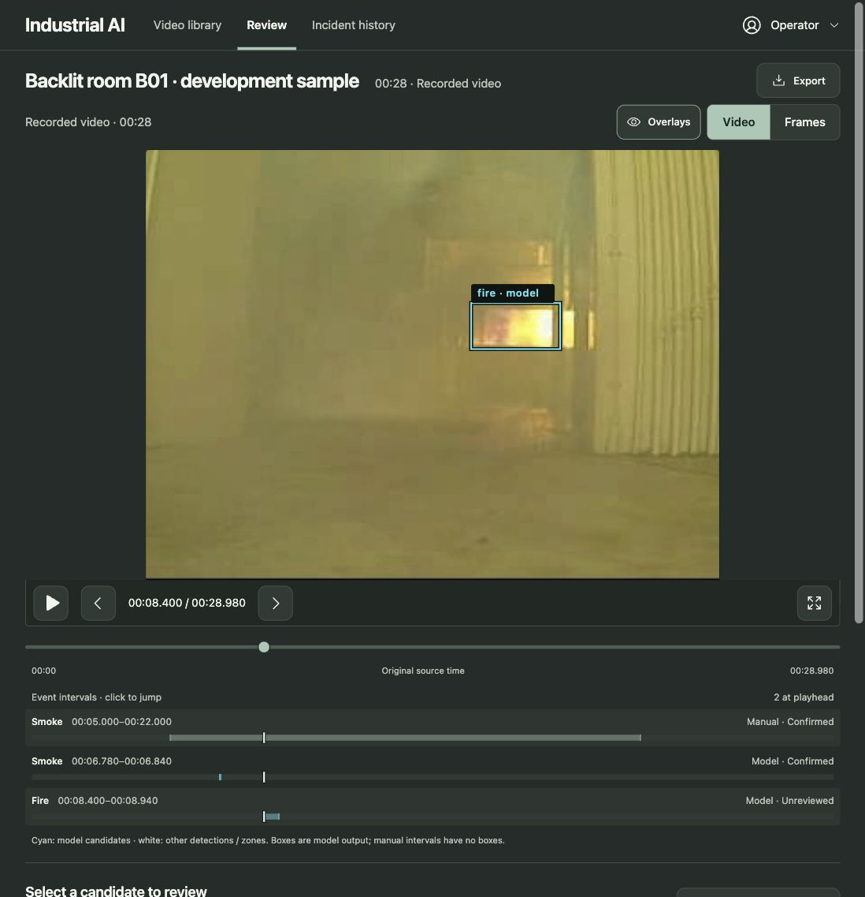
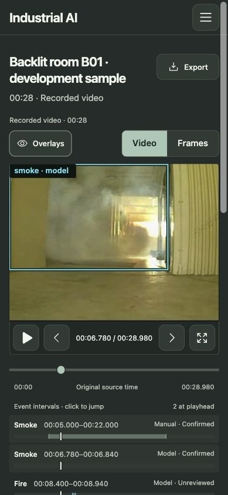

# Evidence-player review — 22 October 2026

The two reported problems were reproduced and corrected in the shared player used by Review and upload setup. Graphite/Sage is preserved; no model, saved review, backend or dependency changed.

## Findings and fixes

- Orange boxes blended with warm video. Candidate boxes now use cyan over a dark outline, with opaque label backgrounds and consistent screen-sized lettering. Other model detections are white. An Overlays toggle permits unobstructed inspection; geometry stays in original source coordinates.
- The seek slider and event strip used the same source timestamps but different horizontal origins and widths. They now share one source-time axis. Each event has its own track and aligned playhead; overlapping events cannot cover one another. Short intervals retain their proportional duration, with a one-pixel visibility floor and a full-row click target.
- Labels now show millisecond precision, manual/model provenance and saved review status. At-playhead highlighting indicates which listed intervals contain the displayed source frame; this does not assert that the detector is correct.
- Video-frame callbacks synchronize overlays with presented frames without repeatedly seeking playback backwards. Source-map stepping pauses playback, and seeks just inside the encoded frame to avoid preview timestamp rounding selecting the previous frame. Timestamp comparisons tolerate sub-microsecond floating-point noise.
- Frames mode uses the actual sampled still's timestamp for its cursor and all playheads. Its helper explains that brief flags require Video mode. Missing still previews disable Frames.

## Evidence and verification

Tested B01 analysis `5cdfb7c8-3951-47ae-90cc-6e29708ea5c8` in the in-app browser at 1098×1137 and 389×843.

| Stored observation | Source interval | Meaning |
| --- | --- | --- |
| Manual smoke | 5.000–22.000 s | Human observation; no spatial boxes |
| Model smoke | 6.780–6.840 s | Brief raw flag |
| Model fire | 8.400–8.940 s | Raw flags grouped into an interval |

Read-only checks against stored raw observations match the displayed smoke box to frame 113 / 6.780 s and fire box to frame 140 / 8.400 s. See `source-evidence.json`. The existing backend groups fire/smoke hits across gaps of up to two seconds; an event interval therefore does not promise a box on every frame. No independent accuracy evaluation or label change was performed.

Browser acceptance:

- Fire jump lands at 8.400 s with the matching box; Next advances to 8.460 s and Previous returns to 8.400 s.
- Smoke jump lands at 6.780 s with its matching box. Next reaches 6.840 s without a floating-point boundary error.
- Play advances normally; Pause stops; switching to Frames aligns the displayed 19.380 s still, slider and all playheads. Switching back preserves that source position.
- Overlay toggle removes/restores boxes. Keyboard End reaches the final source frame at 28.920 s of 28.980 s and reports no listed event, with no stale boxes.
- At 8.400 s, slider-thumb x=335.21798 and all event-playhead x=335.21759 CSS pixels (difference <0.01 px).
- Mobile scroll width equals viewport width (389 px); event-row targets are 48 px high. Seek target is 44 px high.
- Browser warning/error log was empty. Saved review decisions were not edited.

Automated checks: all **17 frontend tests**, TypeScript and production build pass; `git diff --check` passes. Regression cases cover short intervals, overlapping tracks, sampled-still position, overlay contrast/toggle, decoder rounding and playback feedback prevention. Backend tests were not rerun for this frontend-only change.

Native fullscreen could not be confirmed through in-app browser automation. Safari/WebKit and actual remote-client rendering were not exercised. These are remaining compatibility checks, not claimed passes.

## Screenshots

Raw captures include excess browser canvas. `*-view.png` only removes that excess outside the measured viewport; page content is unchanged.

